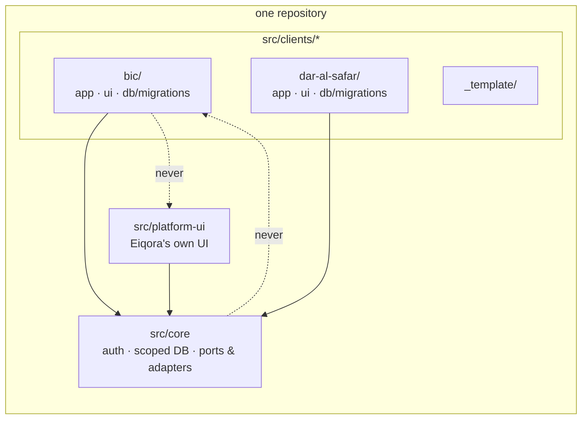
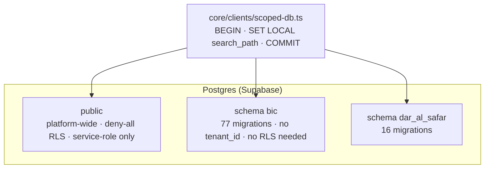

# Eiqora platform — architecture case study

> How a one-repo, schema-per-client platform serves bespoke apps for community institutions
> (a masjid with a madrasa LMS, a travel agency) from a shared core — written up so the design
> can be read without the product code. The source is private; this document is not.

**Author:** Yitbarek Tegene, co-founder of [Eiqora Technologies](https://eiqora.com)
**Live surfaces:** [eiqora.com](https://eiqora.com) (marketing) · `admin.` (operator console) ·
[bic.eiqora.com](https://bic.eiqora.com) (BIC Masjid Platform) · [darulsafar.com](https://www.darulsafar.com)

---

## 1. What the platform is

Eiqora builds **bespoke, per-client software** for institutions that usually run on WhatsApp
threads and spreadsheets — mosques, schools, agencies — and hands each one over to the client's
own staff to run. Two clients are in production today:

| Client | What they got | Surfaces |
|---|---|---|
| **BIC Masjid Platform** (Bangladesh Islamic Center) | Member community app, madrasa learning-management system, registrar, institution admin console ("idara"), student & parent portals, attendance kiosk, lobby-TV signage | `member/*`, `lms/*`, `registrar/*`, `idara/*`, `student/*`, `parent/*`, `kiosk/*` — 91 pages |
| **Dar Al Safar** (travel & concierge agency) | Public site plus internal ops portal: clients, visas, ticketing, cash log, ledger & accounting, staff, insights | `travel/*` — 15 pages |

Each client gets what *looks and feels* like its own product, on its own subdomain, with its own
database schema — while the engineering team maintains one codebase.

## 2. The central decision: bespoke multi-instance, not shared-instance SaaS

The platform started life as a conventional shared-instance multi-tenant SaaS (one app, one
schema, `tenant_id` on every row). It was deliberately re-architected into what the codebase
calls a **bespoke multi-instance platform**:

- **One repository.** A shared `core/` toolkit, and **one folder per client** under
  `src/clients/<slug>/` containing that client's app, UI and migrations.
- **One Postgres database, one schema per client.** Inside a client schema there is **no
  `tenant_id` column and no row-level security** — isolation is *physical*, not a predicate
  that every query must remember to include.
- **A small shared `public` schema** for platform-wide concerns (leads, invoices, the
  community network, content bank, Stripe Connect records, announcements).

Why: institutions want *their* app, not a tenant inside someone else's; they want to be
handed the keys eventually; and the failure mode of a forgotten `WHERE tenant_id = …` is
unacceptable for a school holding children's records. Putting the boundary in the database
makes the common bug class impossible rather than merely unlikely.



**Dependency rules** (enforced by convention and review): clients import only `@/core/*`;
core never imports a client; clients never import `platform-ui`, so Eiqora branding cannot leak
into a client's product.

## 3. Request lifecycle: how a hostname becomes a tenant

Tenant resolution lives in the Next.js edge proxy (`src/proxy.ts`, the Next 16 successor to
`middleware.ts`). Every request goes through it:

1. **Refresh the auth session** (Supabase SSR), skipping prefetches and session-less paths.
2. **Classify the host** as one of three kinds — *gateway* (apex marketing site), *admin*
   (operator console), or *client* (`<sub>.eiqora.com`).
3. **Look up the subdomain** in a static map built from the client configs
   `{ slug, subdomain, name, schema }`. A `<sub>-preview` alias maps Vercel preview deploys to
   the same client. Reserved subdomains are excluded.
4. **Rewrite** the request to `/client/<slug>/...` and **inject headers** carrying the client
   slug, schema and subdomain for everything downstream.
5. **Bounce** any `/admin` request that did not arrive on the admin host.
6. On `localhost` only, accept a dev override so engineers can target a client without DNS.

```mermaid
sequenceDiagram
  participant B as Browser (bic.eiqora.com)
  participant P as proxy.ts (edge)
  participant R as /client/[slug]/[[...path]]
  participant A as src/clients/bic/app
  participant DB as Postgres (schema "bic")
  B->>P: GET /lms/classes
  P->>P: refresh session · classify host · map subdomain → slug/schema
  P->>R: rewrite /client/bic/lms/classes + x-eiqora-client-* headers
  R->>A: dynamic dispatch via route resolver
  A->>DB: BEGIN; SET LOCAL search_path TO "bic", public; …; COMMIT
  DB-->>A: rows
  A-->>B: page
```

The `(client-host)` route group is a thin bridge: `client/[slug]/[[...path]]` plus groups for
`lms`, `registrar`, `member`, `student`, `parent` and `kiosk` dispatch dynamically into the
matching client folder through a route resolver and a module registry — adding a client means
adding a folder and a config entry, not touching the router.

## 4. Database isolation in practice

All client data access goes through one scoped-DB module in core. Three primitives —
`clientRaw`, `clientBatch`, `clientTransaction` — each open a transaction and run
`SET LOCAL search_path TO "<schema>", public` before the query:

- **`SET LOCAL` inside a transaction** is what makes this safe behind Supabase's
  *transaction-mode* connection pooler: the setting dies with the transaction, so a pooled
  connection can never leak one client's `search_path` into another client's request.
- **Schema names are validated** (`assertValidSchemaName`) before they are ever interpolated.
- **Context comes from the request headers** set by the proxy, falling back to the `Host`
  header. For code paths that have *no* request host — the Stripe webhook is the canonical
  example — an `AsyncLocalStorage` context (`runWithClientContext`) forces the tenant from
  trusted event metadata.
- **No ORM.** Queries are raw SQL through `pg`. This was a conscious choice: `search_path`
  semantics stay explicit and reviewable, and nothing silently rewrites table names.
- **The shared `public` schema is locked down**: deny-all RLS with no policies, and privileges
  revoked from the `anon` and `authenticated` roles. All server access uses the service role or
  a direct Postgres connection; client schemas are never exposed through PostgREST.



Migrations are **per client** (`db:migrate:client`), and a scaffold script stamps out a new
client folder from `_template/`.

## 5. Authentication and authorization

- **Identity** is Supabase Auth (magic link, password, and QR *join tokens* for onboarding
  families and students in person).
- **One profile per auth user, many roles.** Rather than a single `role` column, the
  masjid/school client uses a `role_grants` table: a person can be an *instructor* **and** a
  *parent*, each grant independently `active / pending / suspended`. Roles in use: instructor,
  admin, finance_admin, parent, student, member, registrar. People with several roles land on a
  role chooser.
- **Server-side guards** per surface — `require-admin`, `require-staff`, `require-member`,
  `require-guardian`, `require-student`, `require-registrar` — are the only way into a protected
  route; authorization is never left to the client bundle.
- **The operator console is behind Cloudflare Access.** `requireAdmin` verifies the
  `cf-access-jwt-assertion` header through an access adapter (Cloudflare in production, a
  bypass adapter in local dev). Platform staff identity never depends on application-level auth alone.
- The travel-agency client uses a simpler `SUPERADMIN / MANAGER / AGENT` staff model.

## 6. Domain modules

**Masjid / school client** (≈90k lines of TypeScript, 77 migrations):

| Area | Modules |
|---|---|
| Community (`member/*`) | prayer times & reminders, dua board, library (en / bn / ar / am), network listings & moderation, donations, membership plans & tiers, programs & RSVP |
| Madrasa LMS (`lms/*`) | classes & sessions, attendance (incl. kiosk self-marking), **hifz tracking with a ledger**, curriculum, goals, assignments & submissions, quizzes, gradebook & report cards, milestones, staff presence, messaging threads with read tracking, **AI-drafted progress summaries reviewed by staff** |
| Registrar (`registrar/*`) | terms, offerings, payments, term rollover, staff |
| Institution admin — "idara" (`idara/*`) | members, finance, comms, content studio, programs, insights, moderation, plans |
| Portals | student, parent (child switcher), attendance kiosk, lobby-TV signage |

**Travel-agency client** (≈31k lines, 16 migrations): clients, invoices, visa pipeline,
ticketing bookings, concierge arrangements, cash log, formal ledger, employees, accounting,
audit log, lead notifications.

**Platform `public` schema** (44 migrations): leads, invoices, in-house bug tracker, community
network (listings, reports, sales, remittance), client prayer config, dua board, Islamic Q&A,
content bank, Stripe Connect & payment destinations, RSVP/check-in/waitlists, scheduled
announcements, platform identity.

## 7. Integrations through ports and adapters

Core defines **ports** and wires concrete **adapters** in a single container, so a client app
never imports a vendor SDK directly:

| Port | Adapter(s) |
|---|---|
| access | Cloudflare Access · bypass (dev) · Supabase |
| auth / database | Supabase Auth · `pg` |
| payments | Stripe (Checkout for membership, registration, donations, listing sales; Connect for client payouts) |
| email | Resend |
| storage | Cloudflare R2 · Supabase Storage · a routing adapter that picks per use |
| cache / rate limit | Upstash Redis |
| CDN | Cloudflare · null |
| queue | Inngest (event send; a no-op when no key is configured) |

Also: **Web Push** (VAPID) for prayer reminders and dua replies; **Anthropic Claude** for
drafting LMS progress notes and parent messages, always surfaced as *drafts* a human edits and
sends; external content sources (IslamHouse library, Kalimat, Mawaqit prayer screen proxy).

**Scheduled work** runs on Vercel Cron:

| Job | Cadence |
|---|---|
| prayer reminders · warm · publish announcements | every 5 min |
| event reminders · close attendance | hourly |
| community network · bug digest | daily |

## 8. Observability

Next.js `instrumentation.ts` hooks `onRequestError` and posts every server error to an
**in-house bug tracker** living in the platform schema. Bugs are triaged in the operator
console; a daily digest and ops-alert emails go out automatically. No third-party APM —
the tracker doubles as the product's own issue system.

## 9. How it is verified

Honest version: there is no unit-test framework in the repo today. Verification is
**script-driven and environment-first**:

- **~58 `*-verify` / `*-check` scripts** (authorization, schema isolation, finance-access
  rules, payments, cron, messaging) that exercise real code paths against a database.
- **14 `smoke:*` npm scripts** for the main user journeys.
- Everything that can touch email, payments or real data runs against a **Docker sandbox**
  (`docker-compose.sandbox.yml`) with its own Supabase — a rule adopted after learning the hard
  way that test runs must never be able to reach production side effects.
- TypeScript `strict` and `next lint` on every build.
- A series of **structured audits** (full-repo audit, executive remediation plan, six phase
  reports covering payments/cron/messaging, AI/storage/errors, architecture, UX, testing/ops)
  that produced the current roadmap.

Unit tests and CI are the acknowledged next step; the architecture was shaped so that the
isolation guarantees do not *depend* on tests being present.

## 10. Size

| | |
|---|---|
| TypeScript / TSX | 1,248 files · ≈146k lines |
| Pages / route handlers | 204 / 38 |
| SQL migrations | 137 (≈5k lines) across `public` + 2 client schemas |
| Scripts | ≈150 files · ≈20k lines (migrations, verification, smoke, provisioning, media) |
| Docs | master plan, strip plan, deployment/sandbox/provisioning runbooks, 6 audit reports, ~60 feature handoffs |
| History | 775 commits, May – Oct 2026 |

## 11. Decisions worth stealing

1. **Put the tenant boundary in the database, not in a `WHERE` clause.** Schema-per-client
   with `SET LOCAL search_path` is boring, pooler-safe, and removes a whole bug class.
2. **One repo, folder-per-client, strict import direction.** Bespoke apps without bespoke
   infrastructure. The template + scaffold makes "new client" a mechanical step.
3. **Multi-role grants over a single role column.** Real institutions have the teacher who is
   also a parent. Modelling that up front avoided a painful migration later.
4. **Protect the operator console at the edge** (Cloudflare Access) so platform staff access
   never rests on app-level auth alone.
5. **AI as a drafting assistant, never an author.** Model output lands in a drafts table and
   a human sends it. This is what made AI features acceptable to a school.
6. **A sandbox for anything with side effects.** Email, payments and cron must be physically
   unable to reach real people during a test.
7. **Ship the client's languages as content, not as a framework.** The UI is English; the
   library, announcements and Arabic text fields are multilingual with proper RTL — what
   the users actually needed first.

## 12. What is intentionally not in this document

The product code, pricing and fee policy, client data of any kind, hostnames beyond the public
ones, and the contents of internal runbooks. Engineers evaluating this work are welcome to a
walkthrough or time-boxed read access to the repository — ask.

---

## How this was built

Every line was produced by directing AI development tools (Claude Code and Cursor) through
written specifications, phase plans and line-by-line review, with the author as architect,
reviewer and tester. The structured audits above are part of that process: periodic independent
reviews of the AI-generated codebase, each producing a prioritized remediation plan.

<sub>© 2026 Eiqora Technologies. This write-up may be quoted with attribution; the platform it describes is proprietary.</sub>
